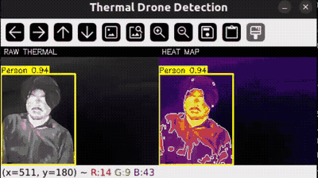

# Thermal Drone Detection

<div align="center">
  
</div>

<p align="justify">
Real-time thermal camera detection for maritime drone operations. Uses YOLO models fine-tuned on aerial thermal infrared imagery to detect people and vehicles from a drone-mounted thermal camera, with a side-by-side heat-map visualization for situational awareness.
</p>

## Demo

<p align="justify">
The GIF above shows live detection with the thermal camera. The left panel displays the raw thermal feed, and the right panel shows the heat-map colormap with hot-spot contours. Bounding boxes are drawn around detected objects — <strong>Person</strong> (yellow), <strong>Car</strong> (red), <strong>Bicycle</strong> (blue), and <strong>OtherVehicle</strong> (purple).
</p>

> **Note:** The thermal models are trained on aerial top-down views (60-130m altitude). Close-up objects during ground testing may produce small or inaccurate boxes — switch to the COCO model (`m` key) for close-up testing.

## Features

- **Live side-by-side display**: raw thermal feed (left) + heat-map colormap (right)
- **Multiple thermal colormaps**: inferno (classic thermal), jet, turbo, hot, magma, viridis
- **Hot-spot contour overlay**: outlines the hottest regions without obscuring the color
- **3 switchable models** (hotkey `m`):
  - **YOLO11s** — fine-tuned on HIT-UAV aerial thermal, best accuracy (~130ms/frame)
  - **YOLOv8n** — fine-tuned on HIT-UAV aerial thermal, faster (~56ms/frame)
  - **YOLO11n COCO** — general-purpose for close-up/ground testing (~56ms/frame)
- **Class filtering** (hotkey `c`): All / Person only / Person+Vehicle
- **Auto-detects the thermal camera** across `/dev/video*` (survives replug/reboot)
- **CPU-only**: runs on Intel i7-1255U without GPU (~7-17 fps depending on model)

## Use Case

<p align="justify">
Designed for a maritime drone conducting search-and-rescue or surveillance. The thermal camera detects people in water or vessels at sea, where visible-light cameras fail at night or in poor weather. The heat-map provides immediate visual feedback on temperature distribution — warm objects (people, engine heat) stand out against cold water.
</p>

## Hardware

| Component | Spec |
|-----------|------|
| Thermal camera | Thermal Cam Co.,Ltd (USB, 256x192, YUYV 4:2:2, 25/50 fps) |
| Laptop | ThinkBook with i7-1255U, 38GB RAM, Intel Iris Xe (no GPU) |
| OS | Ubuntu 22.04 |

## Quick Start

```bash
# 1. Clone
git clone https://github.com/<your-username>/thermal-drone-detection.git
cd thermal-drone-detection

# 2. Install dependencies
pip install -r requirements.txt

# 3. Download model weights
python download_models.py

# 4. Run
./run.sh
```

### Command-line options

```bash
python src/thermal_detect.py --help

# Key options:
  --model yolo11s       # yolo11s (default) | yolov8n | coco11n
  --conf 0.35           # confidence threshold (raise to reduce false positives)
  --colormap inferno    # inferno | jet | turbo | hot | magma | viridis
  --device /dev/video3  # override auto-detection
  --max-area 0.6        # max box area as fraction (reject close-up false positives)
  --hot-pct 90          # hot-pixel percentile for contour overlay
  --imgsz 640           # YOLO inference image size
```

## Controls

| Key | Action |
|-----|--------|
| `q` | Quit |
| `m` | Switch model (yolo11s -> yolov8n -> coco11n) |
| `c` | Cycle class filter (All -> Person -> Person+Vehicle) |
| `h` | Toggle hot-spot contour overlay |
| `s` | Save snapshot to `snap_<timestamp>.png` |

## Models

| Model | File | Dataset | Classes | Params | Inference |
|-------|------|---------|---------|--------|-----------|
| YOLO11s | `thermal_sentinel_yolo11s.pt` | HIT-UAV aerial thermal | Person, Car, Bicycle, OtherVehicle | 9.4M | ~130ms |
| YOLOv8n | `hituav_thermal_yolov8n.pt` | HIT-UAV aerial thermal | Person, Car, Bicycle, OtherVehicle | 3.0M | ~56ms |
| YOLO11n | `yolo11n.pt` | COCO (80 classes) | person, car, truck, bus, boat, etc. | 2.6M | ~56ms |

### Which model to use?

- **Drone at altitude** (looking down from 60m+): `yolo11s` or `yolov8n` — trained on aerial thermal, detects small objects from above
- **Ground testing / close-up**: `coco11n` — handles normal-sized objects at close range (not thermal-trained, but works for testing)

### Training dataset

<p align="justify">
Both thermal models are fine-tuned on the <a href="https://github.com/suojiashun/HIT-UAV-Infrared-Thermal-Dataset">HIT-UAV dataset</a> — the first publicly available high-altitude UAV-based infrared thermal dataset:
</p>

- 2,898 thermal images from 43,470 frames
- Altitude: 60-130 meters
- Camera angle: 30-90 degrees
- Day and night conditions
- Classes: Person, Car, Bicycle, OtherVehicle, DontCare

Reported accuracy (YOLOv8n, 10 epochs):
| Class | mAP50 |
|-------|-------|
| Car | 0.962 |
| Person | 0.878 |
| Bicycle | 0.812 |

The YOLO11s model uses thermal-aware training: disabled color jitter (`hsv_h=0, hsv_s=0`), controlled value shifting (`hsv_v=0.4`), and two-stage learning rate annealing.

## Heat-map Colormaps

<p align="justify">
The thermal feed is normalized to full 0-255 range before applying the colormap, ensuring accurate color representation:
</p>

| Colormap | Gradient | Description |
|----------|---------|-------------|
| `inferno` (default) | black -> purple -> orange -> yellow -> white | Classic thermal imaging look |
| `jet` | blue -> green -> yellow -> red | Rainbow |
| `turbo` | blue -> cyan -> green -> yellow -> red | Improved rainbow |
| `hot` | black -> red -> yellow -> white | Traditional FLIR-style |
| `magma` | black -> purple -> orange -> white | Perceptually uniform |
| `viridis` | blue -> green -> yellow | Perceptually uniform |

## Project Structure

```
thermal-drone-detection/
├── src/
│   └── thermal_detect.py      Main detection script
├── models/
│   ├── thermal_sentinel_yolo11s.pt   YOLO11s thermal (download)
│   ├── hituav_thermal_yolov8n.pt      YOLOv8n thermal (download)
│   └── yolo11n.pt                    YOLO11n COCO (download)
├── docs/                      Screenshots and documentation images
├── download_models.py          Download model weights
├── requirements.txt           Python dependencies
├── run.sh                     Convenience launcher
├── .gitignore
└── README.md
```

## Notes

<p align="justify">
- The thermal camera needs ~40 warmup frames before producing valid data (first frames are black)
- USB reconnection may change `/dev/videoN` — the script auto-detects by device name
- The aerial thermal models produce small bounding boxes by design (objects are small from altitude)
- For close-up testing, switch to the COCO model (`m` key) which handles larger objects
</p>

## Credits

- [baturalpoz06/thermal-object-detection-yolov8](https://github.com/baturalpoz06/thermal-object-detection-yolov8) — YOLOv8n thermal model
- [AmirhosseinBagherinia-dl/thermal-sentinel-yolo11](https://github.com/AmirhosseinBagherinia-dl/thermal-sentinel-yolo11) — YOLO11s thermal model
- [suojiashun/HIT-UAV-Infrared-Thermal-Dataset](https://github.com/suojiashun/HIT-UAV-Infrared-Thermal-Dataset) — Training dataset
- [Ultralytics](https://github.com/ultralytics/ultralytics) — YOLO framework

## License

This project uses models and code from multiple sources. See individual model repositories for their respective licenses.
